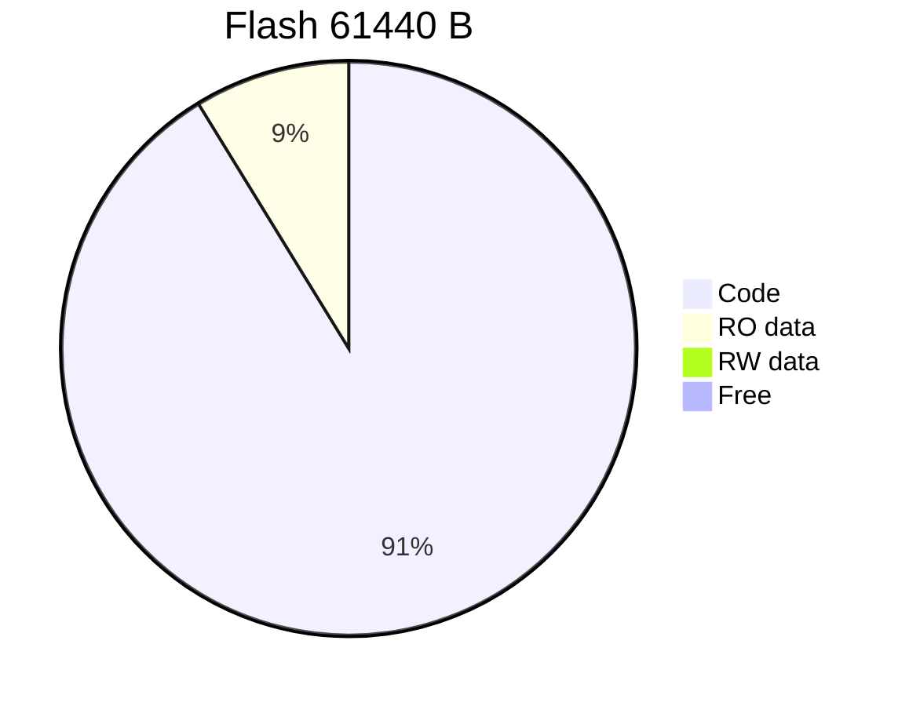
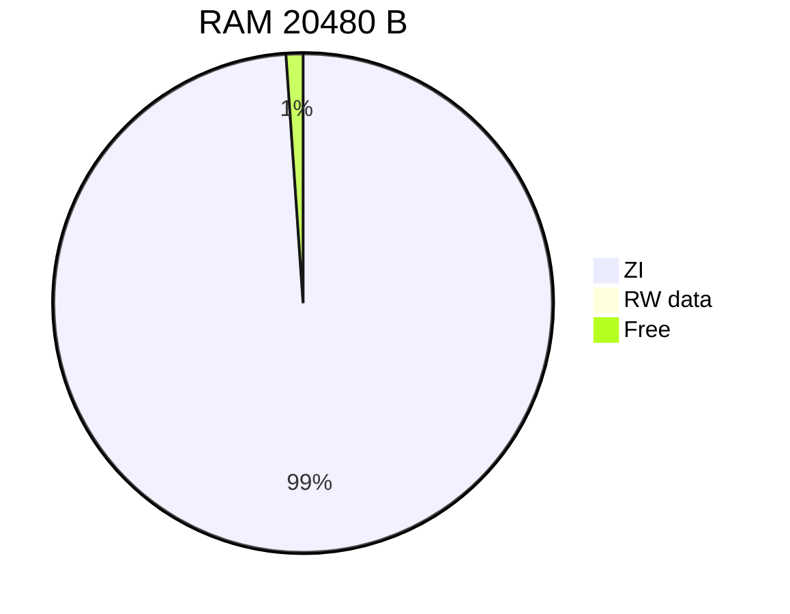

# 项目架构与资源占用总结

## 一页架构图

```text
 DHT11  超声波  Rd-03  MQ2/MQ135  OLED  ESP8266
   |       |       |       |         |       |
   +-------+-------+-------+---------+-------+--> SensorTask / NetTask
                                                     |
                                             DataHub 快照
                                                     |
       PA0/PC13/PB15 --> MenuTask              AlarmTask
                              |                  |
                              +------> Storage/LogTask
                                         |       |
                                  W25Q64 KV/事件  RGB/SG90/TB6612
                                         |
                                   MQTT telemetry/event/config
```

## 数据流

1. 驱动层把值、质量、时间戳写入 DataHub；业务任务只读快照，不直接访问传感器。
2. AlarmTask 用质量位、过期时间和持续确认计时决定 `SELF_TEST/FAULT/DISARMED/WARMUP/ARMED/ALARM`。
3. 状态变化同时驱动 RGB、风扇、舵机，写入 RAM 事件环并排队持久化。
4. NetTask 通过 ESP8266 TCP 链路承载 MQTT；命令经校验后投递配置/执行器，最终回 `queued/done/rejected`。
5. StorageTask 通过 SPI 仲裁器访问 W25Q64；配置双 Bank，事件使用 16 个日志扇区。

## 任务与资源

| 任务 | 优先级 | 栈 words | 职责 |
|---|---:|---:|---|
| MonitorTask | 5 | 192 | 心跳、栈/堆、水位、喂狗 |
| AlarmTask | 4 | 256 | 状态机、联动、安全态 |
| NetTask | 3 | 512 | AT、TCP-MQTT、URC、命令 |
| SensorTask | 2 | 256 | 传感器采样、DataHub、RTC |
| MenuTask | 2 | 384 | OLED、按键、Manual Test |
| LogTask | 1 | 256 | 事件/配置异步落盘 |

## Flash / RAM 饼状数据

### Flash（总 ROM 61416 B / 61440 B）

| 分区 | 字节 | 占已用 Flash |
|---|---:|---:|
| Code | 55992 | 91.17% |
| RO data | 5376 | 8.75% |
| RW data | 48 | 0.08% |
| 空余 | 24 | 0.04%（相对容量） |

```text
Flash used  [Code 91.17%][RO 8.75%][RW 0.08%] | free 0.04%
```



### RAM（总 RW+ZI 20256 B / 20480 B）

| 分区 | 字节 | 占已用 RAM |
|---|---:|---:|
| RW data | 48 | 0.24% |
| ZI（含 11 KB FreeRTOS heap、任务栈、DMA/业务缓冲） | 20208 | 99.76% |
| 空余 | 224 | 1.09%（相对容量） |

```text
RAM used   [ZI 99.76%][RW 0.24%] | free 1.09%
```



## 资源结论

- 当前固件已接近 60 KiB Flash 和 20 KiB RAM 红线；M9 不新增运行时代码。
- 蜂鸣器已删除以保留 `APP_MQ_DO_ENABLED=1`、MQ 电平安全、KV 双副本、20 条离线事件和故障钩子。
- 任何二期功能必须先提交独立 map、栈水位和 64 KB 可行性评估。
